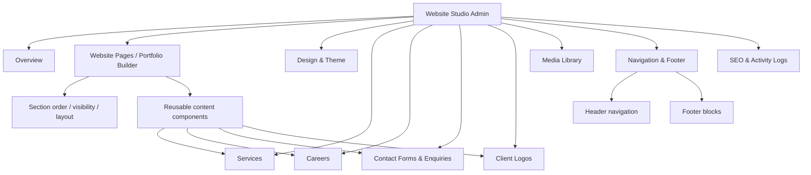
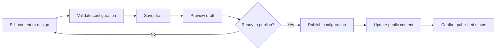

# Healthcare Portfolio Website Studio
## Product Plan, Admin UI/UX Specification & Visual Prototypes

> **Purpose:** A customizable portfolio CMS for a healthcare services company. The administrator can manage content, page composition, appearance, services, careers, contact forms, client logos, navigation and footer without editing code.


**Prototype status:** The images in this document are illustrative UI mockups created to communicate layout and behavior. They are not a functioning application and do not represent a specific client's actual brand.

---

## 1. Product goals

- Deliver a modern, responsive healthcare portfolio with polished typography, color, imagery and subtle animation.
- Give a non-technical administrator control over page content, section order, visibility, layout and appearance.
- Manage **Services**, **Careers**, **Contact Forms & Enquiries**, and **Client Logos** as independent modules.
- Reuse the same content in multiple locations without duplicating records.
- Keep the infrastructure simple and low-cost.

## 2. Proposed technology stack

| Layer | Technology | Purpose |
|---|---|---|
| UI | Next.js + TypeScript | Public portfolio and admin interface |
| Validation | Zod | Typed validation for editor settings and forms |
| Styling | Tailwind CSS | Design system and responsive layout |
| Motion | CSS animations / Framer Motion | Controlled transitions and reveal effects |
| Database | Supabase PostgreSQL | Pages, sections, services, jobs, forms, enquiries, logos |
| Authentication | Supabase Auth | Admin login and session management |
| File storage | Supabase Storage | Public brand assets and private files where needed |
| Hosting | Cloudflare Pages | Static portfolio deployment |
| Security | Supabase RLS | Restrict access to unpublished content and submissions |

### Static hosting architecture note

This plan assumes a **static-friendly Next.js export** on Cloudflare Pages. Static pages can fetch published content from Supabase at runtime, or content changes can trigger a rebuild/deployment. Static export does not provide Next.js server actions or request-time server rendering. If those capabilities become requirements, revisit the hosting architecture before implementation.

## 3. Information architecture



### Core design principle

**Content management and page composition are separate.**

- The Services module owns service records.
- Careers owns job records.
- Contact Forms owns form configurations and submissions.
- Client Logos owns client/logo records.
- The Portfolio Builder determines where these records appear and how they are presented.
- Removing a section from a page must not delete its underlying records.

---

## 4. Visual design system

### 4.1 Suggested color palette

| Token | Suggested value | Usage |
|---|---|---|
| Primary navy | `#12304A` | Sidebar, headings, footer |
| Secondary navy | `#1B4965` | Secondary headings and accents |
| Healthcare teal | `#13A89E` | Primary actions and active states |
| Pale blue | `#EAF5FA` | Highlight backgrounds |
| Page background | `#F5F9FC` | Admin workspace |
| Surface | `#FFFFFF` | Cards and forms |
| Main text | `#203447` | Body text |
| Muted text | `#63798A` | Hints and secondary labels |
| Border | `#D8E5EC` | Dividers and card outlines |
| Success | `#16845B` | Published/resolved state |
| Warning | `#D97706` | Draft/in-progress warnings |
| Error | `#C2414B` | Validation and destructive actions |

```text
NAVY       #12304A  ██████
TEAL       #13A89E  ██████
PALE BLUE  #EAF5FA  ██████
SURFACE    #FFFFFF  ██████
TEXT       #203447  ██████
BORDER     #D8E5EC  ██████
```

Use theme tokens rather than hard-coded colors in individual components. Let the administrator select presets such as Clinical Blue, Healthcare Green, Modern Neutral, Corporate Navy, or Custom Brand.

### 4.2 Typography and visual rules

- Use a curated font list (web-safe fonts or approved font sources).
- Provide global heading, body, navigation and button font settings.
- Expose font size, weight, line height and letter spacing.
- Provide reset-to-theme-default actions.
- Warn about poor text contrast.
- Keep animation optional and respect `prefers-reduced-motion`.
- Do not permit arbitrary CSS or executable HTML in the CMS.

---

## 5. Global admin shell

### Desktop layout

- **Left sidebar:** approximately 240 px, collapsible.
- **Top bar:** breadcrumbs, save state, preview, save draft and publish.
- **Main workspace:** tables, forms or page editor.
- **Contextual settings panel:** approximately 320–400 px when editing a section.
- **Responsive fallback:** side panels become drawers; mobile uses one-column forms and move-up/move-down controls.

Sidebar entries:

1. Overview
2. Website Pages
3. Design & Theme
4. Services
5. Careers
6. Contact Forms & Enquiries
7. Client Logos
8. Media Library
9. Navigation & Footer
10. SEO Settings
11. Activity Logs
12. Account Settings

## 6. Admin prototype: Dashboard


### Dashboard content

- Summary cards: published pages, active services, open vacancies and new enquiries.
- Recent enquiries table with status.
- Recently edited content.
- Quick actions: edit homepage, add service, create job, customize theme and view enquiries.

Keep this dashboard focused on tasks the client performs regularly.

---

## 7. Website Pages & Portfolio Builder


### 7.1 Page list

Initial pages:

- Home
- About Us
- Services
- Careers
- Contact Us

Each row/card shows page name, URL slug, publication status, last updated date, preview and edit actions. Additional pages may be created from supported templates.

### 7.2 Builder layout

The editor has three main zones:

1. **Section list:** order, drag handle, visibility state, edit, duplicate and delete.
2. **Preview canvas:** desktop/tablet/mobile preview of the public page.
3. **Settings panel:** Content, Layout, Style and Animation tabs.

### 7.3 Section cards and behavior

Example order:

1. Hero Banner — Visible
2. About the Company — Visible
3. Services Showcase — Visible
4. Client Logos — Visible
5. Careers Preview — Hidden
6. Contact CTA — Visible

Each section supports:

- Drag-to-reorder and accessible move-up/move-down controls.
- Visibility toggle.
- Expand/collapse.
- Edit.
- Duplicate.
- Remove from page.

Reordering updates the draft order. Stable IDs must preserve content while sections move. Hidden sections retain their configuration. The public site uses the published order, never unsaved draft order.

### 7.4 Add Section library

Group section types:

| Category | Components |
|---|---|
| Hero & introduction | Hero banner, text introduction, image + text, statistics strip |
| Services | Service grid, service list, featured service, service carousel |
| Trust | Client logos, testimonials, certifications, statistics |
| Content | Rich text, image gallery, brochure download, video embed |
| Conversion | Contact CTA, contact form, careers preview, link cards |

Only supported component layouts should be shown for each component type.

### 7.5 Section settings tabs

**Content**
- Heading, subheading, body text.
- Buttons and destinations.
- Image, alt text and crop position.
- Repeater items such as cards, logos and testimonials.

**Layout**
- One/two/three/four columns.
- Image-left or image-right.
- Full-width or contained.
- Grid, list or carousel.
- Content alignment, image ratio, section padding.
- Mobile stacking order.

**Style**
- Background, heading, body, link and button colors.
- Font family, size, weight, line height and letter spacing.
- Border, radius and spacing.
- Reset to theme default.

**Animation**
- None, fade, fade-up, slide or scale.
- Duration, delay and stagger.
- Respect reduced-motion preferences.

---

## 8. Design & Theme Studio

Provide theme presets and live preview.

### Global controls

- Primary, secondary and accent colors.
- Page and surface backgrounds.
- Main and muted text colors.
- Heading and button colors.
- Heading/body/navigation/button fonts.
- Typography scale.
- Content max width.
- Default section spacing.
- Card radius and button shape.
- Header height and footer layout.

Preview modes: Desktop, Tablet and Mobile.

Theme edits remain draft until published. Global theme values act as defaults; section-specific style overrides take precedence.

---

## 9. Services module


### Service record

- Name and slug.
- Short and full description.
- Image and alt text.
- Optional icon.
- Benefits/features.
- CTA label and destination.
- SEO title and description.
- Draft/published/archived state.
- Featured-on-home setting.
- Display order and timestamps.

### Services showcase settings

The Portfolio Builder can display all published services or a manually selected subset. Configure:

- Selected services and their order.
- Grid or carousel.
- Number of columns.
- Card style and image placement.
- Image ratio and card spacing.
- Whether descriptions and buttons appear.
- Button label and destination.

The same service record can appear on the homepage, Services page and other sections without duplicating the data.

---

## 10. Careers module

### Careers dashboard

Show total, published, draft, closed and expired jobs.

### Job record

- Title, department and location.
- Employment type and experience requirements.
- Short and full description.
- Responsibilities and qualifications.
- Optional benefits.
- Publication and closing dates.
- External application URL.
- SEO metadata.
- Status: Draft, Published, Closed or Archived.

### Careers page configuration

Configure page introduction, job card layout, optional filters, empty-state message, Apply button style and application link behavior.

The Apply button opens the configured Google Form or external application portal. External applications are collected by that external service, not by the portfolio database.

### Placement

Careers can be linked from navigation, footer, homepage preview or a CTA. Removing a link does not delete the Careers page or job records.

---

## 11. Contact Forms & Enquiries


### 11.1 Form Builder

Support multiple forms, such as General Contact, Request a Quotation and Partnership Enquiry.

Supported field types:

- Short text
- Email
- Phone
- Long text
- Dropdown
- Radio buttons
- Checkboxes
- Consent checkbox

Each field has a stable internal key, label, placeholder, help text, required state, validation rules, options and order.

Actions: add, edit, duplicate, reorder and remove fields; configure submit button, success message and publication status; preview before publishing.

If a field is removed or renamed, preserve historical submissions and their original values.

### 11.2 Submissions inbox

Columns:

- Submission ID
- Form name
- Submitter name, if collected
- Email/phone, if collected
- Date
- Status

Detail view shows all submitted fields. Admin actions include search, filters, New/In Progress/Resolved status, internal notes, CSV/XLSX export and retention-policy-based deletion.

### 11.3 Placement

A published form can be embedded on the Contact page, homepage, service page or supported CTA. Footer forms should be optional; a simple Contact link or CTA is the default.

### 11.4 Security

- Validate submitted values with Zod at a trusted boundary.
- Apply rate limiting and spam protection.
- Prevent public users from reading submissions.
- Keep secret keys out of browser code.
- Collect only necessary personal information.

---

## 12. Client Logos module


### Logo record

- Organization name.
- Logo image.
- Alt text.
- Optional destination URL.
- Display order.
- Publication status.

### Fixed-ratio logo containers

Default ratio: **4:3**. Use `object-fit: contain`, consistent padding and centered alignment so logos of different shapes are not stretched or cropped.

Configurable settings:

- Grid or carousel.
- Desktop column count.
- Mobile spacing.
- Container ratio.
- Maximum logo width/height.
- Background, border and radius.
- Show/hide organization names.
- External link behavior.
- Carousel autoplay, speed, arrows and indicators.

The logo component should use selected existing records. Removing a logo from a section must not delete the logo record itself.

---

## 13. Media Library

Provide image search and management with:

- Preview, file name, type and size.
- Alt text and upload date.
- Upload, replace and remove actions.
- Search and filtering.
- Reference checks before deletion.

Separate public brand assets from private documents. CVs, if ever collected by this website, must not be exposed through the public media library.

---

## 14. Header, Navigation and Footer Builder

### Header controls

- Logo and company name.
- Navigation labels, destinations and order.
- Visibility of links.
- Header background/text colors.
- Sticky header option.
- Main CTA.
- Mobile menu behavior.

### Footer content

- Logo and company description.
- Address, phone and email.
- Social media links.
- Quick links, service links and Careers/Contact links.
- Privacy policy and terms links.
- Copyright text.
- Optional contact CTA.

### Footer layouts

- One, two, three or four columns.
- Column order and visibility.
- Stacked mobile layout.
- Colors, spacing, typography and link styling.

The administrator can add links to published pages, service pages and approved external URLs. Navigation visibility is independent from page publication.

---

## 15. Publishing workflow



Required states:

- Saving
- Saved
- Draft
- Publishing
- Published
- Publish failed

Preserve saved drafts if deployment fails.

### Static export publishing decision

Choose one of these approaches:

1. **Runtime content fetch:** static page shell fetches published data from Supabase. Updates can appear without rebuilding, but the latest content is not necessarily present in initial HTML.
2. **Rebuild on publish:** publishing triggers a secure deployment/build. This is better when the published content must be embedded in generated HTML, but updates depend on build completion.

Do not expose drafts through public queries. Keep draft and published configuration logically separate.

---

## 16. Suggested database model

| Table | Purpose |
|---|---|
| `pages` | Page identity, slug, status and SEO metadata |
| `page_sections` | Section type, order, visibility, layout and structured content |
| `site_settings` | Theme, typography, header and footer settings |
| `services` | Reusable service records |
| `jobs` | Career openings and application URLs |
| `contact_forms` | Form configuration and publication state |
| `contact_form_fields` | Stable field definitions and order |
| `contact_submissions` | Submitted values, timestamps and status |
| `client_logos` | Reusable client/partner logos |
| `navigation_items` | Header and navigation configuration |
| `footer_blocks` | Footer columns and reusable content |
| `admin_users` | Admin profile/role mapping, if required beyond Auth |
| `audit_logs` | Important admin changes |

Use stable IDs and explicit sort-order fields. Use JSONB for validated, versioned component-specific configuration where appropriate. Avoid duplicating service or logo content inside each page section; store references to the original records.

---

## 17. Security and production readiness

- Enable Supabase Row Level Security on exposed tables.
- Public visitors can read only published and explicitly enabled content.
- Only authorized administrators can edit CMS content.
- Restrict contact submissions to inserts; never grant public read access to enquiries.
- Keep Supabase service-role credentials server-side only.
- Validate external URLs and all uploaded files.
- Use private buckets for sensitive documents.
- Add spam controls and rate limits.
- Log important administrative changes.
- Configure backups and test restoration.
- Test keyboard access, contrast, reduced motion and responsive behavior.
- Test publication failure recovery.
- Avoid storing unnecessary personal data.

---

## 18. Implementation roadmap

### Phase 1 — Core CMS
- Authentication and dashboard.
- Page management.
- Section builder.
- Content editing, reordering and visibility.
- Draft/save/publish states.

### Phase 2 — Design system
- Theme presets and custom colors.
- Typography controls.
- Layout settings.
- Header/footer builder.
- Responsive preview.

### Phase 3 — Content modules
- Services management.
- Careers management.
- Contact form builder and submissions inbox.
- Client logo library.
- Media library and exports.

### Phase 4 — Production readiness
- RLS and permission tests.
- Form spam controls.
- Audit logs.
- Backup and restore.
- SEO and accessibility.
- Performance testing.
- Cloudflare deployment and publish workflow.

## 19. Acceptance criteria

1. Admin can edit all supported content without code changes.
2. Sections can be reordered without losing data.
3. Hidden sections are not rendered publicly.
4. Draft changes remain private.
5. Theme and layout changes work across screen sizes.
6. Services, jobs, forms and logos are managed independently.
7. Shared records update consistently wherever they are referenced.
8. External Apply links work and are validated.
9. Enquiries are visible only to authorized administrators.
10. Client logos fit consistent containers without distortion.
11. Public forms are validated and protected against abuse.
12. Publishing failures preserve saved work.
13. Database permissions prevent unauthorized writes.
14. Public pages remain accessible, responsive and performant.

---

## 20. Final design direction

The Studio should feel like a controlled visual website editor, not a developer console. Keep common tasks obvious, provide sensible defaults, and reveal advanced style settings only when needed.

The public site should feel modern, calm and trustworthy: spacious layouts, readable typography, accessible color contrast, high-quality healthcare imagery, restrained motion and a consistent design system.

**All images in this document are visual prototypes for discussion.** They should guide the UI implementation, not be used as production UI assets.
